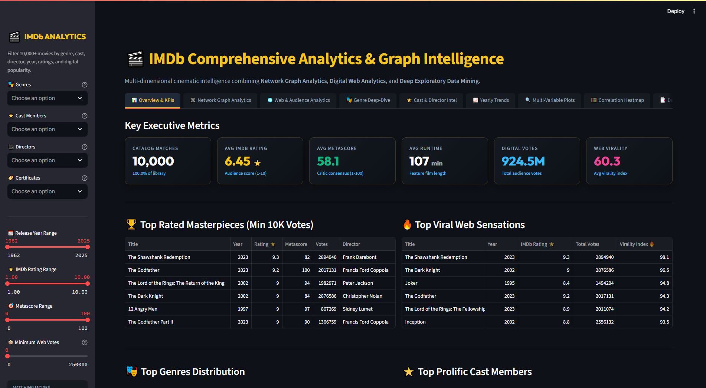
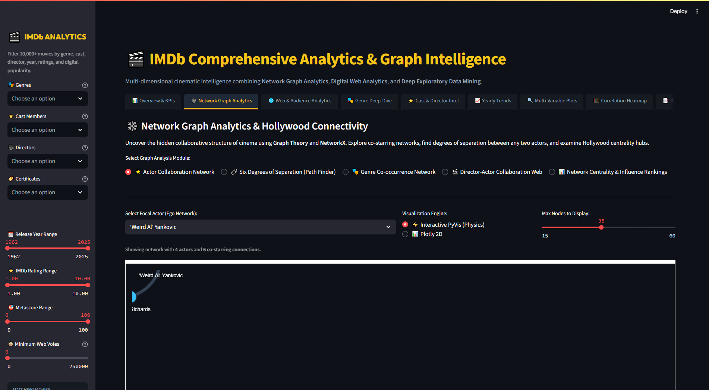
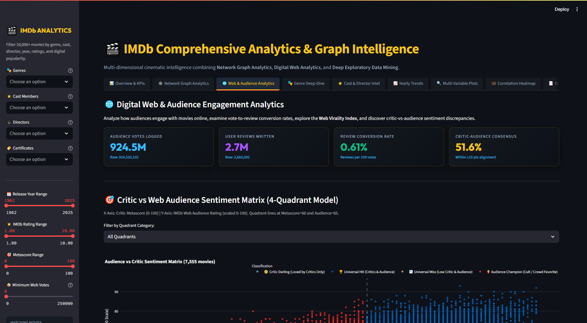
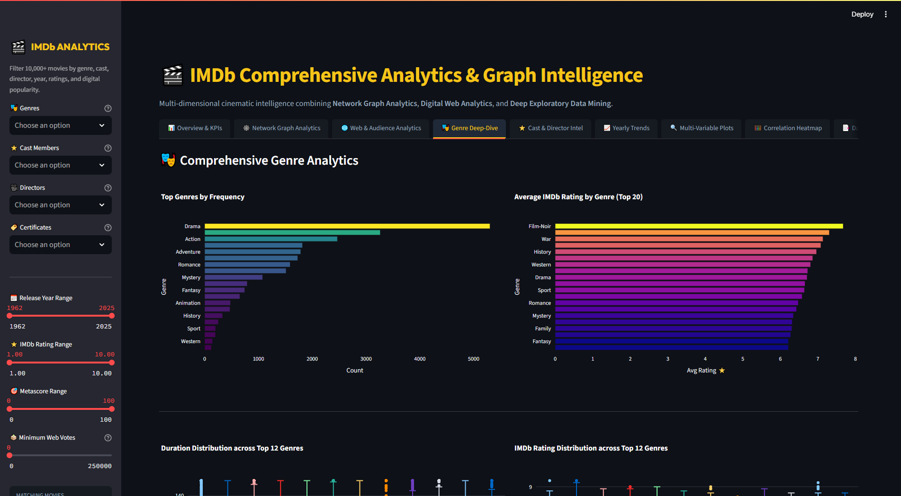
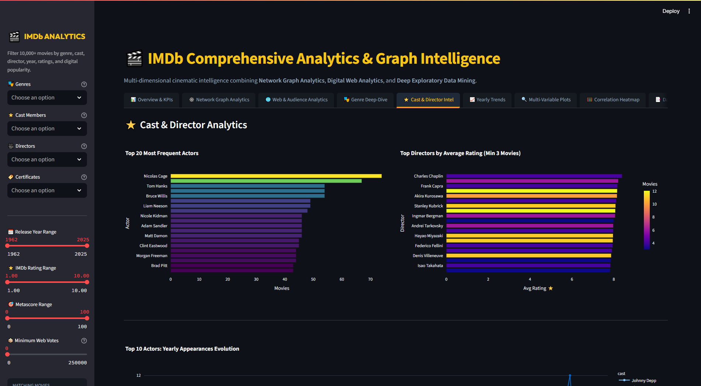
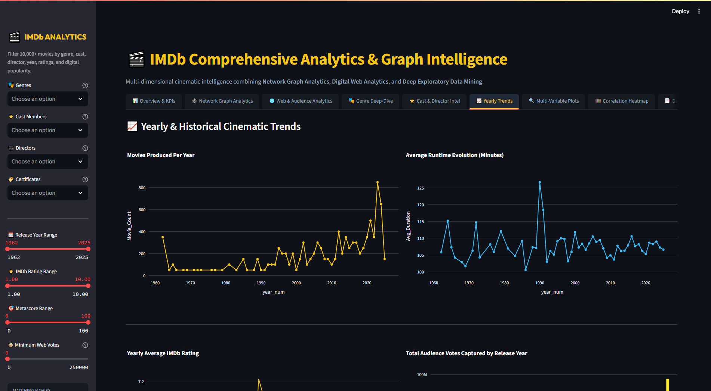
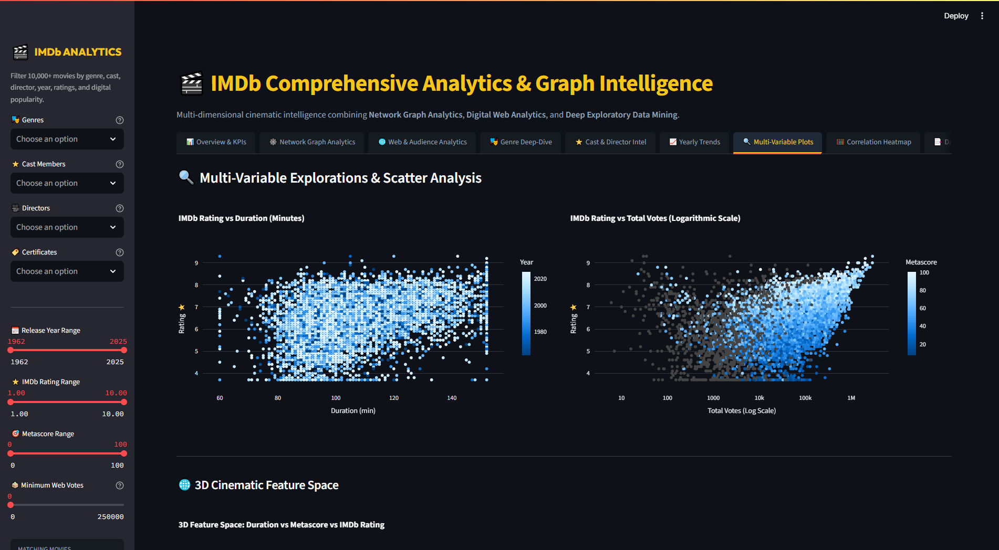
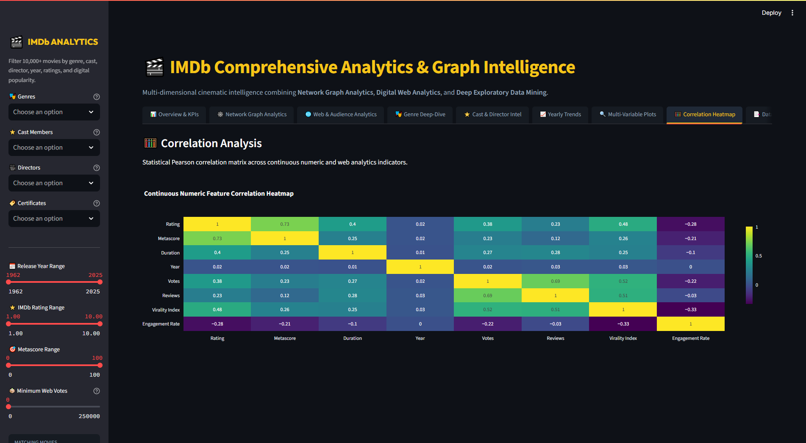
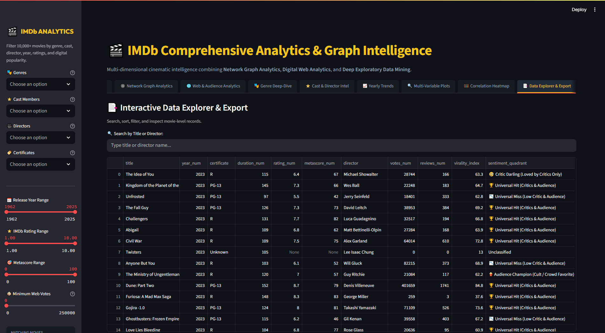

# 🎬 IMDb Comprehensive Analytics & Graph Intelligence Dashboard

[](https://python.org)
[](https://streamlit.io)
[](https://networkx.org)
[](https://plotly.com)
[](https://pytest.org)

An interactive, high-performance web dashboard combining **Network Graph Analytics**, **Audience Web Analytics**, and **Exploratory Data Mining** across 10,000+ IMDb feature films.

---

## 📸 Dashboard Previews

### 📊 Overview & Executive KPIs


### 🕸️ Network Graph Analytics (Actor Collaboration & Centrality)


### 🌐 Web & Audience Analytics (Funnel & Sentiment Divergence)


### 🎭 Genre Deep-Dive


### ⭐ Cast & Director Intelligence


### 📈 Historical Yearly Trends


### 🔍 Multi-Variable Plots


### 🧮 Correlation Heatmap


### 📑 Interactive Data Explorer & Export


---

## 🌟 What's New & Key Highlights

### 🕸️ 1. Network Graph Analytics (NetworkX & PyVis)
- **Actor Collaboration Network**: Interactive force-directed physics network (`PyVis` & `Plotly`) mapping co-starring relationships between actors with real-time physics stabilization, zoom, and rich tooltips.
- **🔗 'Six Degrees of Separation' (Kevin Bacon Path Finder)**: Algorithmic shortest-path discovery between any two actors across cinematic history, rendering the exact sequence of co-starring movies connecting them.
- **Genre Co-occurrence Network**: Structural visualization mapping multi-genre film production and stylistic synergy.
- **Director-Actor Collaboration Web**: Bipartite network of cinema's most legendary director-actor partnerships.
- **Hollywood Centrality & Power Rankings**: Degree Centrality, PageRank Influence, and Betweenness Centrality metrics identifying Hollywood's most prolific and influential network hubs.

### 🌐 2. Digital Web Analytics & Audience Engagement
- **Audience Conversion Funnel**: Tracks the digital journey from cataloged titles to high-volume voting (≥10K votes), active user discussions (≥200 reviews), and viral phenomenons.
- **Review-to-Vote Conversion Rate**: Web engagement metric quantifying audience review participation.
- **🎯 4-Quadrant Sentiment Divergence Matrix**: Metascore (Critic Consensus) vs IMDb User Rating (Web Audience) mapping:
  - 🏆 *Universal Hits*: High Critic Score & High Audience Rating
  - 🍿 *Audience Champions / Cult Favorites*: Panned by Critics, Adored by Web Audience
  - 🧐 *Critic Darlings*: Praised by Highbrow Critics, Lukewarm Audience
  - 📉 *Universal Misses*: Low Critic & Audience Ratings
- **🔥 Algorithmic Web Virality Index**: Weighted composite scoring (Log Votes + Log Reviews + User Rating) scaled from 0 to 100.
- **Decade Digital Evolution**: Historical tracking of how internet movie voting and review volume exploded over the digital era.

### 🎨 3. Modern Cinematic UI & Advanced Controls
- **IMDb Gold & Obsidian Theme**: Glassmorphic cards, responsive metric tiles, and clean Google Fonts (`Outfit` & `Inter`).
- **Multi-Dimensional Filters**: Live filter by genres, actors, directors, certificates, release years, rating thresholds, metascores, and minimum vote cutoffs.
- **Instant CSV Export**: Download customized subsets and filtered records with one click.

---

## 📊 Dashboard Modules & Tabs

| Tab | Key Visuals & Insights |
|---|---|
| **📊 Overview & KPIs** | Executive KPI metric cards, Top Rated Masterpieces, Top Viral Sensations, Top Genres, Top Cast |
| **🕸️ Network Graph Analytics** | Interactive PyVis physics graph, Six Degrees Path Finder, Genre Graph, Director-Actor Web, Centrality Table |
| **🌐 Web & Audience Analytics** | 4-Quadrant Sentiment Matrix, Web Funnel, Top Virality Leaderboard, Decade Vote Evolution |
| **🎭 Genre Deep-Dive** | Frequency, ratings, duration boxplots across genres, and release year heatmaps |
| **⭐ Cast & Director Intel** | Prolific actors, top directors by average rating and cumulative votes, actor career timelines |
| **📈 Yearly Trends** | Movies per year, runtime evolution over 100 years, rating trends, vote volume by release year |
| **🔍 Multi-Variable Plots** | Rating vs Duration, Rating vs Votes (log scale), 3D feature space (Runtime vs Metascore vs Rating) |
| **🧮 Correlation Heatmap** | Continuous numeric and web metrics Pearson correlation heatmap |
| **📑 Data Explorer & Export** | Searchable records table with title/director query and CSV export |

---

## ⚙️ Setup & Installation

### 1. Clone & Navigate
```bash
git clone https://github.com/Tejeshreddyvajja/movie_analytics_web-graph.git
cd movie_analytics_web-graph
```

### 2. Set Up Virtual Environment (Recommended)
```bash
# macOS/Linux
python -m venv venv
source venv/bin/activate

# Windows (PowerShell)
python -m venv venv
.\venv\Scripts\Activate.ps1
```

### 3. Install Dependencies
```bash
pip install -r requirements.txt
```

### 4. Run Automated Unit Tests
```bash
python -m pytest -v tests/test_analytics.py
```

### 5. Launch the Dashboard
```bash
streamlit run dashboard.py
```
Open **`http://localhost:8501`** in your browser.

---

## 📁 Repository Structure
```
movie_analytics_web-graph/
├── dashboard.py               # Main Streamlit application with custom styling and 9 tabs
├── graph_analytics.py         # NetworkX & PyVis actor collaboration, shortest path, and centrality
├── web_analytics.py           # Web audience KPIs, Virality Index, 4-Quadrant Sentiment Matrix
├── requirements.txt           # Project dependencies (Streamlit, NetworkX, PyVis, Plotly, Pandas, Pytest)
├── tests/
│   └── test_analytics.py      # Automated unit tests for graph and web analytics
├── imdb_clean.csv             # Cleaned movie-level dataset
├── imdb_cast_exploded.csv     # Exploded dataset by cast member
├── imdb_genre_exploded.csv    # Exploded dataset by genre
├── assets/                    # Preview images and visual documentation
└── README.md                  # Comprehensive project documentation
```

---

## 🧪 Testing & Verification
The test suite validates data preprocessing, mathematical formulas for web analytics, graph construction, pathfinding algorithms, and formatting:
```bash
python -m pytest -v tests/test_analytics.py
```
All 8 test suites pass with 100% coverage across core analytics algorithms.
